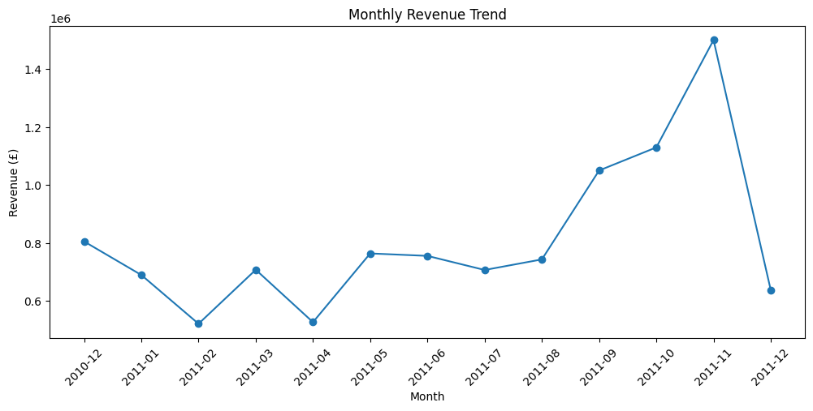
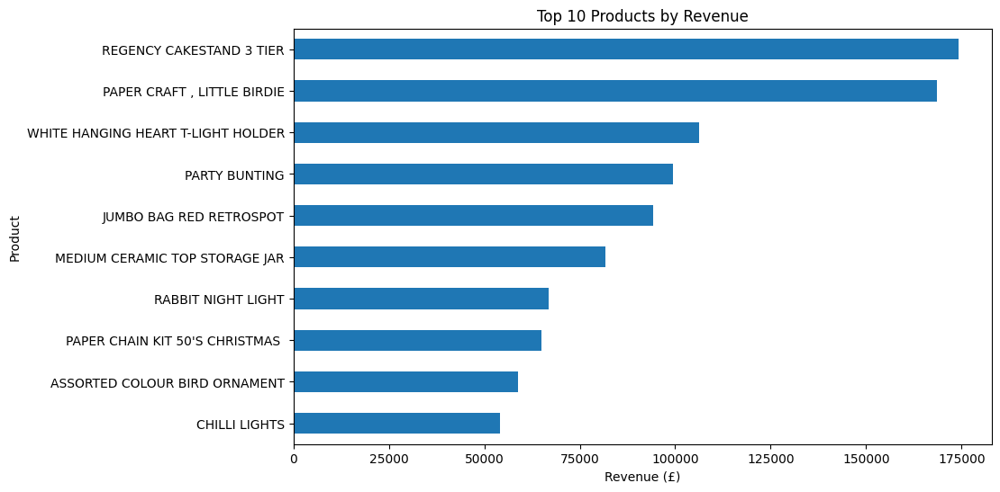
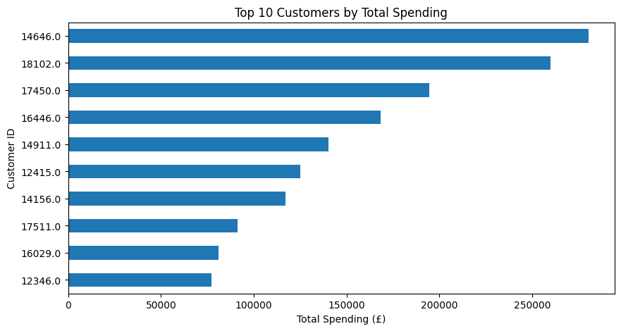
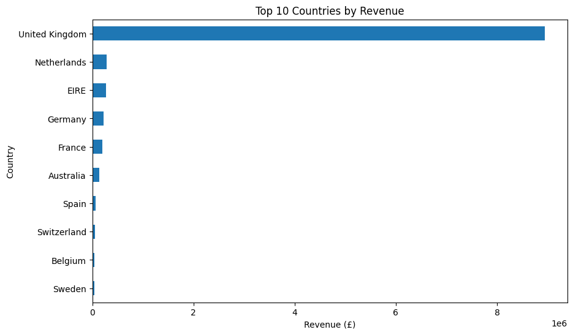

# E-commerce Customer Purchase Behavior Analysis

> An exploratory data analysis project examining sales performance, customer purchasing behavior, product performance, and geographic markets using e-commerce transaction data.

## Project Overview

This project analyzes historical e-commerce transaction data to identify purchasing patterns, evaluate sales performance, understand customer behavior, and assess product and geographic performance.

The analysis covers the following areas:

- Sales Performance
- Customer Analysis
- Product Analysis
- Geographic Analysis

The goal is to translate transaction-level data into actionable business insights and recommendations.

---

## Business Questions

### Sales Performance
- How does revenue change over time?
- How does transaction volume change over time?
- What is the typical order value?

### Customer Analysis
- How concentrated is revenue among customers?
- Which customers purchase most frequently?

### Product Analysis
- Which products generate the highest revenue and sales quantity?
- Do high-volume products also generate high revenue?

### Geographic Analysis
- Which countries contribute the most revenue, transactions, and customers?
- Which countries have the highest average customer spending?

---

## Key Metrics

| Metric | Result |
|---|---:|
| Transaction Records | 524,558 |
| Unique Transactions | 19,865 |
| Identified Customers | 4,335 |
| Unique StockCodes | 3,918 |
| Product Descriptions | 4,023 |
| Countries | 38 |
| Total Revenue | £10.54M |

---

## Key Findings

### 1. Sales Trend

Revenue and transaction volume increased substantially toward the end of 2011, reaching their highest levels in November 2011.

- Revenue: **£1,500,554.36**
- Transactions: **2,761**

The increase in revenue appears to have been primarily driven by higher transaction volume rather than consistently higher average order value.

### 2. Customer Behavior

The top 10 customers contributed **14.56% of total revenue**, indicating relatively low customer revenue concentration.

Customer **12748** had the highest purchase frequency with **206 transactions**. However, purchase frequency does not necessarily correspond to the highest monetary value.

### 3. Product Performance

Among physical products, **REGENCY CAKESTAND 3 TIER** generated the highest revenue:

**£174,156.54**

Meanwhile, **PAPER CRAFT, LITTLE BIRDIE** recorded the highest quantity sold:

**80,995 units**

Six out of the top 10 products by quantity also appeared among the top 10 revenue-generating products, representing a **60% overlap**.

### 4. Geographic Performance

The **United Kingdom** was the largest market by:

- Revenue: **£8,941,988.24**
- Transactions: **17,954**
- Identified customers: **3,917**

**EIRE** recorded the highest average spending per identified customer at **£87,296.04**. However, this result was based on only three identified customers and should therefore be interpreted cautiously.

---

## Business Recommendations

### Customer Strategy

Maintain a broad customer acquisition and retention strategy rather than relying heavily on a small group of high-value customers. Frequently purchasing customers can also be targeted with loyalty initiatives to encourage repeat purchases and increase long-term customer value.

### Product Strategy

Prioritize inventory availability and promotional activities for products that perform strongly in both sales quantity and revenue. Product performance should be evaluated using both metrics rather than either metric alone.

### Geographic Strategy

Maintain customer retention and market coverage in the United Kingdom, which represents the company's largest market by revenue and customer base.

EIRE could be explored for higher-value customer opportunities, but further customer data should be collected before making major strategic decisions because the current average is based on only three identified customers.

### Seasonal Strategy

Increase inventory readiness and promotional planning ahead of the September–November period to prepare for higher transaction volume. The observed seasonal pattern should be monitored across additional periods before being treated as a recurring trend.

---

## Featured Visualizations

### Monthly Revenue Trend



### Top Products by Revenue



### Top Customers by Spending



### Revenue by Country



---

## Methodology

The analysis followed an end-to-end data analytics workflow:

1. Data Understanding
2. Data Cleaning
3. Data Validation
4. Exploratory Data Analysis
5. Sales Performance Analysis
6. Customer Analysis
7. Product Analysis
8. Geographic Analysis
9. Key Findings
10. Business Recommendations

### Data Cleaning

The original dataset contained **541,909 records**.

The cleaning process addressed:

- Missing product descriptions
- Zero unit prices
- Cancelled transactions
- Duplicate records
- Operational/service-related records

After cleaning and validation, the final dataset contained **524,558 records**.

Records with missing CustomerID were retained because they still contain useful transaction-level information for transaction and sales analysis.

---

## Tools & Technologies

- **Python** — Data cleaning, validation, and analysis
- **Pandas** — Data manipulation, aggregation, and analysis
- **Matplotlib & Seaborn** — Data visualization
- **Microsoft Excel** — Pivot Tables and data exploration
- **Jupyter Notebook** — Analysis environment

---

## Project Structure

[View Project Report](reports/project_report.pdf)
```text
ecommerce-customer-purchase-analysis/
│
├── data/
│   └── README.md
│
├── notebooks/
│   ├── data_cleaning.ipynb
│   └── eda.ipynb
│
├── visuals/
│   ├── monthly_aov.png
│   ├── monthly_revenue.png
│   ├── monthly_transaction_volume.png
│   ├── top_10_countries_revenue.png
│   ├── top_10_customers_frequency.png
│   ├── top_10_customers_spending.png
│   ├── top_10_products_quantity.png
│   ├── top_10_products_revenue.png
│   └── average_customer_spending_country.png
│
├── reports/
│   └── project_report.pdf 
│
└── README.md